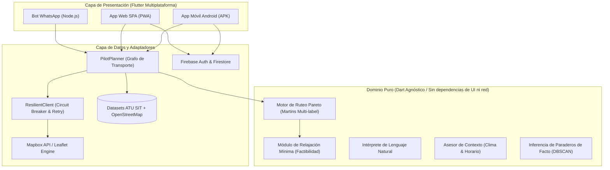

# Rutéalo

**Planificador inteligente de viajes por Lima que respeta tu presupuesto real y cuánto puedes caminar.**  
Compara transporte público, caminata y tramos de taxi corto *únicamente donde conviene*, calculando con exactitud matemática qué ganas y qué sacrificas en cada alternativa.

> Proyecto presentado en **Hack the Andes 2026** · Track *Movilidad y Transporte* · Reto: **Transporte público en Lima, rutas y tiempos**.
> 
> 📦 **Descarga directa de APK (Android):** [**Descargar Rutéalo APK (Google Drive)**](https://drive.google.com/file/d/1PNwmu7K5jSkCmNdfdg6BpK97lBzZYoUI/view?usp=sharing)

---

## El problema y para quién

En Lima, combinar corredores, buses, caminata y taxi es una decisión compleja de **dinero, esfuerzo físico y certidumbre** que millones de ciudadanos realizan a ciegas:
* **Google Maps, Moovit y Waze** optimizan exclusivamente por **tiempo** y asumen un viaje binario (*todo bus* o *todo taxi/auto*). No consideran cuánto dinero te queda en el bolsillo ni tus limitaciones físicas.
* **Valeria**, estudiante universitaria de noche con S/ 8 y mochila pesada: necesita saber si le conviene tomar un taxi de 600 metros para cruzar una zona oscura y empalmar con otro corredor sin superar su presupuesto.
* **Rosa**, saliendo del mercado con compras pesadas: prioriza la alternativa más económica que minimice el esfuerzo físico.
* **Diego**, con saldo remanente ajustado: necesita replanificar su ruta con los S/ 5.50 exactos que le quedan.

---

## Solución y Características Clave

* **Planificación con restricciones duras**: Presupuesto monetario exacto (en céntimos), caminata seguida máxima y caminata acumulada total. Ningún itinerario sugerido quiebra las condiciones fijadas.
* **Optimización multiobjetivo con dominancia de Pareto**: Genera hasta 3 alternativas óptimas no dominadas (más económica, menor caminata y balanceada), explicando claramente el balance costo vs. tiempo vs. esfuerzo.
* **Relajación mínima asistida**: Si un destino no es alcanzable con las restricciones fijadas, el sistema nunca muestra una pantalla vacía de error; calcula el **cambio mínimo indispensable de una sola variable** (*"Te faltan S/ 0.50"* o *"Aceptando caminar 150 m adicionales llegas a destino"*).
* **Intérprete en lenguaje natural**: Procesamiento de texto cotidiano (*"tengo 7 soles y no quiero caminar más de 3 cuadras"*) traducido a parámetros formales verificables antes de ejecutar.
* **Contexto urbano en tiempo real**: Integración con el clima de Lima (Open-Meteo) y el horario para ajustar automáticamente la tolerancia a la caminata bajo lluvia o de noche.
* **Seguimiento GPS y notificaciones locales**: Monitoreo tramo a tramo, avisos de proximidad de paradero, transbordo y llegada a destino.
* **Taxi compartido para tramos puente**: Salas colaborativas para compartir gastos de taxi en tramos difíciles o inseguros.
* **Bot conversacional de WhatsApp**: Asistente complementario en Node.js (Baileys) para planificar rutas directamente desde chats cotidianos.

---

## Arquitectura del Sistema

El proyecto sigue principios de **Clean / Screaming Architecture**, garantizando desacoplamiento total y portabilidad multiplataforma inmediata (Android y Web):



1. **Dominio Puro (`lib/features/trip_planner/domain`)**: Lógica matemática pura. Al compilar a Web, el motor de ruteo ejecuta directamente en el navegador del cliente en memoria, con latencia p50 de 270 ms sin saturar servidores externos.
2. **Capa de Datos (`lib/features/trip_planner/data`, `lib/core/network`)**: Patrón Repository con cliente resiliente (`ResilientClient`) tolerante a fallos de conexión.
3. **Presentación (`lib/features/trip_planner/presentation`)**: Interfaces adaptativas para smartphone y navegadores de escritorio.

---

## Cobertura y Datos

* **Red de Transporte**: Piloto con **13 rutas** estructuradas de los corredores complementarios de Lima (**Corredor Azul, Corredor Morado y Corredor Rojo**).
* **Fuentes Oficiales**: Cruce de datos de la Autoridad de Transporte Urbano para Lima y Callao (ATU) y OpenStreetMap (OSM) mediante scripts de preparación reproducibles en Python ([`tools/`](tools)).
* **Tarifas Reales**: Modelo tarifario oficial de la ATU por abordaje (abril 2026) y estimaciones transparentes de taxi corto.

---

## Cómo Ejecutar el Proyecto

### Requisitos
* Flutter SDK (3.47+ probado)
* Android SDK (para compilar APK móvil)
* Node.js v20+ (para el bot de WhatsApp)
* Python 3.10+ (para regenerar datasets con scripts de `tools/`)

### 1. Aplicación Flutter (Android y Web)

Desde el directorio `app/cyber_bros`:

```powershell
# Instalar dependencias
flutter pub get

# Ejecutar en modo desarrollo
flutter run -d chrome                 # Versión Web
flutter run -d <id_dispositivo>       # Versión Android

# Compilar para producción
flutter build web --release           # Genera SPA en build/web
flutter build apk --release           # Genera APK en build/app/outputs/flutter-apk/
```

> 📲 **Descarga directa:** Puedes instalar el APK compilado directamente sin necesidad de compilarlo en local desde [**Google Drive (Rutéalo APK)**](https://drive.google.com/file/d/1PNwmu7K5jSkCmNdfdg6BpK97lBzZYoUI/view?usp=sharing).

### 2. Probar la versión Web en local

Una vez compilada la versión web, puedes servir los archivos estáticos optimizados con cualquier servidor HTTP:

```powershell
# Desde el directorio app/cyber_bros:
python -m http.server 8085 -d build/web
# Abrir en el navegador: http://localhost:8085
```

### 3. Bot de WhatsApp

Desde el directorio `services/whatsapp_bot`:

```powershell
npm install
node bot.js
# Escanea el código QR generado en terminal para vincular la sesión
```

---

## Pruebas y Calidad de Código

El proyecto cuenta con **95 pruebas automatizadas** que validan la solidez del motor y las reglas de negocio bajo integración continua ([`ci.yml`](.github/workflows/ci.yml)):

* **Viajes de Oro**: Validación matemática de rutas con tarifas justas y límites estrictos.
* **Algoritmo de Relajación**: Cálculo determinista de cambios mínimos ante problemas infactibles.
* **Seguridad y Resiliencia**: Pruebas de simulación frente a ataques adversarios a paraderos y fallas de red.

Para correr la suite de pruebas:

```powershell
flutter test
flutter analyze lib
```

---

## Documentación Técnica Detallada

Para los jurados y evaluadores que deseen profundizar en las decisiones de diseño:
* [Arquitectura de Software y Decisiones](docs/ARCHITECTURE.md)
* [Modelo de Amenazas y Seguridad](docs/THREAT_MODEL.md)
* [Métricas de Rendimiento y Benchmarks](docs/PERFORMANCE.md)
* [Metodología y Fuentes de Datos](docs/DATA_SOURCES.md)
* [Política de Privacidad y Manejo de Ubicación](docs/PRIVACY.md)
