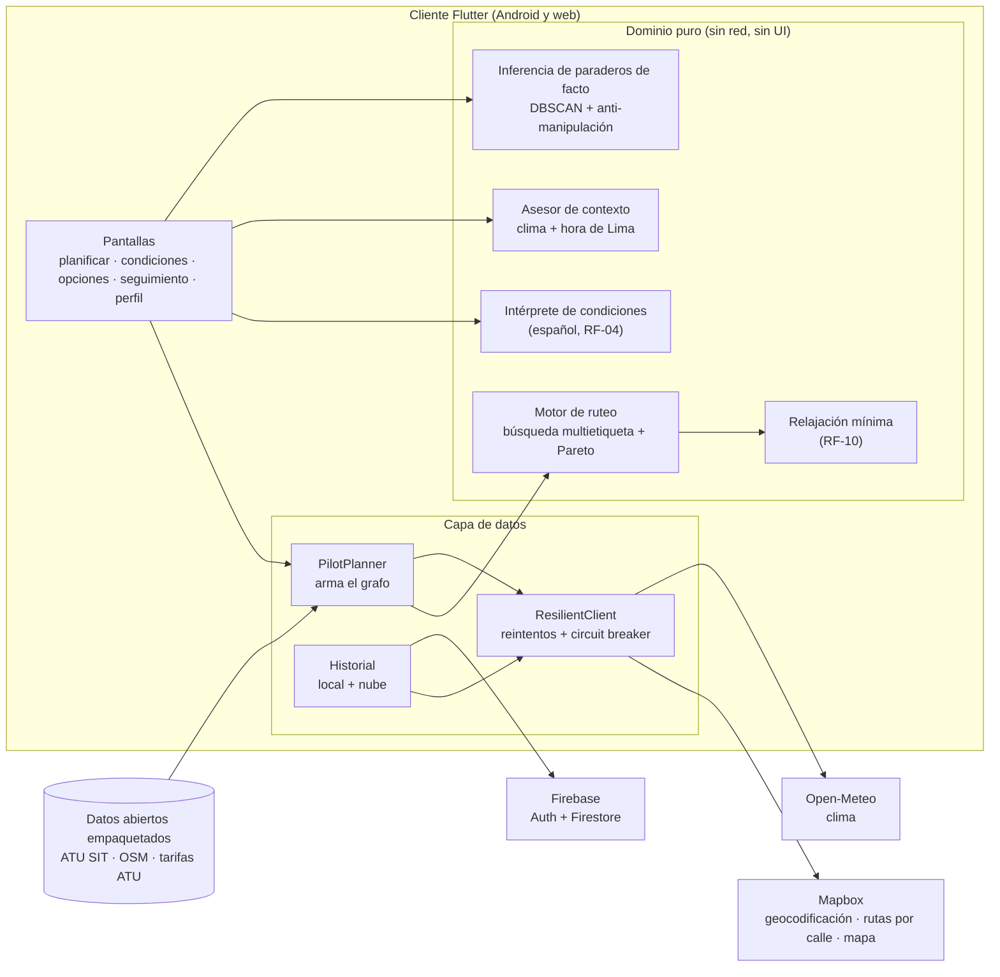

# Arquitectura de Cyberon

Cyberon planifica viajes por Lima combinando transporte público, caminata y un taxi corto
solo donde conviene, **respetando el presupuesto y la caminata máxima de cada persona**.

## Vista general

## Capas y por qué

| Capa | Contenido | Decisión |
|---|---|---|
| **Dominio** (`lib/features/trip_planner/domain`) | Motor, relajación, intérprete, contexto, inferencia | Dart puro: no importa red ni Flutter. Se prueba con resultados exactos y no depende de servicios caídos. |
| **Datos** (`.../data`) | Construcción del grafo desde el catálogo de corredores, Mapbox, Open-Meteo, Firestore, historial | Todo servicio externo pasa por `ResilientClient`; ninguno es punto único de falla. |
| **Presentación** (`.../presentation`) | Pantallas y widgets | Sin lógica de negocio: llaman al dominio. |

## El motor de ruteo

Búsqueda **multietiqueta** (tipo Martins) sobre un grafo en memoria. Cada etiqueta lleva
`(costo, caminata total, caminata seguida, tiempo, transbordos, taxis)` y se descartan las
**dominadas** (Pareto). Las restricciones del usuario son **duras**: una arista que las rompe
nunca se expande.

* Una tarifa por **abordaje** (no por tramo), en céntimos enteros.
* **Taxi puente**: un tramo corto de taxi entre dos puntos de transporte, con la fórmula
  `max(5.00, 3.50 + 1.25·km + 0.25·min) × factor de hora punta`, siempre marcada **estimada**.
* Selección de hasta **3 alternativas** distintas (más barata, menos caminata, equilibrada…).
* **Relajación mínima** (`relaxation.dart`): si no hay recorrido, se exploran por separado las
  tres restricciones (presupuesto, caminata, taxi) y para cada itinerario candidato se mira qué
  viola. Si viola **una sola**, ese itinerario define el cambio mínimo. Nunca se aplica solo.

## Otras piezas técnicas

* **Intérprete en español** (`condition_parser.dart`): números en palabras y dígitos, cuadras,
  "ya gasté", "sin taxi". No inventa valores; valida rangos; el usuario confirma lo entendido.
* **Contexto** (`context_advisor.dart`): lluvia (Open-Meteo) y noche (hora de Lima, UTC−5)
  sugieren reducir la caminata. Solo sugiere.
* **Inferencia de paraderos de facto** (`stop_inference.dart`): ver
  [THREAT_MODEL.md](THREAT_MODEL.md). DBSCAN en metros, `nEff` de fuentes independientes,
  cuarentena, decaimiento y reversión.
* **Tolerancia a fallos** (`resilient_client.dart`): tiempo máximo, reintento, *circuit breaker*
  por servidor, funciona en web (`package:http`).
* **Cuentas e historial**: Firebase Auth por REST (la app nunca guarda contraseñas) y Firestore
  por REST con el token del usuario; reglas de seguridad **versionadas** en
  [`firebase/firestore.rules`](../firebase/firestore.rules), todo denegado por defecto.
* **Taxi compartido**: salas en Firestore para repartir el taxi de un tramo (cupo validado por
  el cliente; limitación declarada).

## Datos

Ver [DATA_SOURCES.md](DATA_SOURCES.md). El catálogo se **empaqueta** en la app (no se consulta en
Firestore): son datos casi inmutables, de lectura masiva, y así el motor no depende de la red.

## Lo que quedó fuera (a propósito)

* **Cobertura de toda Lima**: el piloto cubre 13 relaciones de ruta de los corredores Azul, Morado y
  Rojo. Fuera de ellas solo se ofrece ir a pie o en taxi directo, si caben en los límites.
* **Tiempo real de buses**: no hay datos abiertos de posición; los tiempos de espera son estimados.
* **Servidor propio**: no lo hay. La inferencia de paraderos corre en el cliente con trazas
  simuladas; con usuarios reales haría falta un backend que valide y agregue.
* **Push (FCM)**: las notificaciones son locales (viaje en curso, siguiente paso, cercanía,
  llegada, feedback y recordatorio de viaje planificado).
* **Pago o reserva de taxi**: se contrata en el servicio externo.
* **Accesibilidad física** de los recorridos (rampas, escaleras): no se promete.
